# TSEC Placement Portal

A full-stack Training & Placement portal for **Thadomal Shahani Engineering College**. It has two portals:

- **Student portal.** Students register, build a profile, upload a resume, see which drives they're eligible for (and why), apply, and track every round.
- **TPO portal.** The T&P cell verifies student profiles, reviews resumes, manages companies and drives, **assigns students to drives** (one by one, in bulk, or with an override), moves applicants through rounds, records selections, posts announcements, and exports reports.

It runs on one laptop. Everything except sending emails works **offline**; without internet, OTP codes are shown in the server window instead of being emailed.

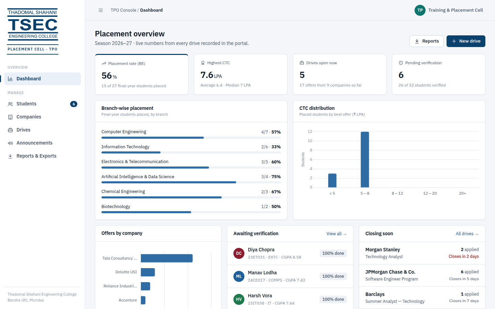

---

## 1. Quick start

**You need:** [Node.js](https://nodejs.org) **version 20 or newer** (install the LTS version).

```bash
npm install        # run once, with internet
npm start          # starts the portal
```

Then open **http://localhost:3000**. The terminal also shows an address other phones and laptops on the same Wi-Fi can use.

### First login (TPO)

The first start creates a settings file called **`.env`** and a TPO account from it:

| | |
|---|---|
| Email | `tpo@tsec.edu` |
| Password | `Tsec@2026` |

Change both in `.env` **before** the first start, or change the password later from the portal (top-right menu → *Change password*).

Students **create their own accounts** with a real email address. The portal emails them a 6-digit code (OTP) to confirm the address before the account exists.

### Set up email (Gmail, about 5 minutes)

1. Use a Gmail account for the placement cell, for example `tsecplacements@gmail.com`.
2. Turn on **2-Step Verification**: https://myaccount.google.com/security
3. Create an **App password**: https://myaccount.google.com/apppasswords (name it "TSEC Portal"). Google shows a 16-letter password.
4. Open the `.env` file in the project folder (Notepad is fine) and fill in:
   ```
   SMTP_USER=tsecplacements@gmail.com
   SMTP_PASS=abcd efgh ijkl mnop
   MAIL_FROM=TSEC Placement Cell <tsecplacements@gmail.com>
   ```
5. Restart the server (**Ctrl + C**, then `npm start`). The terminal should say **"Email: ✔ sending from …"**.

**Until email is set up, the portal still works:** every OTP and email is printed in the server's terminal window, so you can test without internet.

Optional: set `ALLOWED_EMAIL_DOMAIN=yourcollege.domain` in `.env` to allow only college email addresses.

### Useful commands

| Command | What it does |
|---|---|
| `npm start` | Start the portal |
| `npm run reset` | Delete **everything** (students, drives, …) and keep only the TPO login. Use before the real season starts |
| `npm run demo` | Delete everything and load **sample data** (32 students, 9 companies, 11 drives) to practise or present. Sample students sign in as `student1@demo.tsec.edu` / `student123` and never receive emails |

A running server picks up `reset` and `demo` automatically, so just refresh the browser.

---

## 2. Tech stack

| Layer | Technology | Why |
|---|---|---|
| Frontend | HTML5, CSS3, vanilla JavaScript | No framework. Every page is a plain `.html` file plus one `.js` file |
| Styling | One stylesheet (`public/css/style.css`) using CSS variables | Includes a light/dark theme and a responsive layout for phones |
| Charts | Chart.js (served locally from `node_modules`) | Works offline |
| Fonts | IBM Plex Sans / Mono (served locally) | Works offline |
| Server | Node.js + Express 5 | REST API and serving the pages |
| Database | SQLite via **sql.js** | The whole database is one file: `data/portal.db` |
| Auth | `express-session` (httpOnly cookie) + `bcryptjs` password hashing | |
| Uploads | `multer`, PDF only, max 2 MB, checked by file signature | |
| Email | `nodemailer` over SMTP (Gmail app password) | OTP codes + placement notifications |
| Settings | `dotenv` (`.env` file) | TPO login, email account, allowed email domain |

> **Why sql.js and not better-sqlite3?** `better-sqlite3` has to compile C++ code during `npm install`, which often fails on college/Windows laptops that don't have Visual Studio build tools. `sql.js` is the same SQLite engine compiled to WebAssembly, so `npm install` works on any machine with any Node version. The code saves the database file to disk after every write.

---

## 3. Architecture

```
 Browser  (http://localhost:3000)
 ├── index.html               login / student registration
 ├── student/*.html           student portal pages
 └── tpo/*.html               TPO portal pages
        │  fetch('/api/…')  JSON + session cookie
        ▼
 Express server  (server.js)
 ├── guardPages               /student/* only for students, /tpo/* only for the TPO
 ├── /api/auth                register, login, logout, me, change password
 ├── /api/student/*           requireLogin + requireRole('STUDENT')
 ├── /api/tpo/*               requireLogin + requireRole('TPO')
 ├── /api/files/resume/:id    private: only the owner or the TPO
 └── lib/eligibility.js       ONE place that decides who can apply
        ▼
 db.js  →  data/portal.db (SQLite)        uploads/resumes/*.pdf
```

**Example request flow:** The TPO clicks **Assign all eligible** → `public/js/tpo/drive.js` calls `POST /api/tpo/drives/7/assign` → the middleware checks that the session belongs to the TPO → `routes/tpo.js` checks each student with `checkEligibility()` → it inserts the applications in one transaction and creates a notification for each student → it returns JSON → the page re-renders and shows a toast.

---

## 4. Features

### Student portal
- **Register with a real email address.** The portal emails a **6-digit OTP**; the account is only created once the code is entered. Codes expire in 10 minutes, allow 5 attempts, and can be re-sent after 45 seconds. Nobody can register as TPO.
- **Forgot password** with an emailed code.
- **Email notifications** when the TPO verifies the profile, assigns a drive, moves them to a round, selects or rejects them.
- **Dashboard** with a greeting, a verification status banner, a profile-strength ring with a missing-items checklist, stat tiles, "closing soon" drives, offers, and the latest announcements.
- **Profile** with personal, academic and skills/links sections. Academic fields are **locked after TPO verification**; the TPO can unlock them with a remark.
- **Resume upload** by drag-and-drop or click, with a progress bar. PDF only, 2 MB maximum, and the file's signature is checked. Uploading again replaces the old resume.
- **Drives** with the tabs Open / Eligible for me / Applied / Closed, plus search and a job-type filter. Every drive shows **each criterion as ✓ or ✗** (CGPA, backlogs, branch, year, 10th, 12th/diploma, the dream-offer rule), a deadline countdown, a details modal, and **Apply**.
- **My applications**: a round-by-round tracker (Applied → the drive's own rounds → Selected). It shows where a student was rejected and lets them withdraw before being shortlisted.
- **Notifications bell**: verified, assigned by TPO, shortlisted for a round, selected, rejected.
- **Announcements** meant for all students, the student's branch, or the drives they applied to, with "new" markers.

### TPO portal
- **Dashboard** showing:
  - placement rate
  - highest, average and median CTC
  - open drives and pending verifications
  - branch-wise placement bars
  - CTC distribution chart
  - offers by company
  - the verification queue, drives closing soon, and recent registrations
- **Students**:
  - search by name, roll number, email or skill
  - filter by branch, year, verification, placement, CGPA and backlogs
  - sort, paginate, and export the filtered list to CSV
  - bulk actions: **Verify** and **Assign to drive**
- **Student profile**:
  - academics at a glance and an **inline resume preview** with download
  - every detail the student entered, plus their applications
  - verify, request changes (with a remark), unlock for edits
  - **eligibility against every open drive**, with one-click Assign
- **Companies**: add, edit, delete and search, with contact details, number of drives and offers, and the top CTC. Use "+ Drive" to create a drive for that company.
- **Drives**: create and edit with eligibility rules (min CGPA, max backlogs, min 10th/12th, branches, years), custom selection rounds, deadline and drive date. You can close and reopen registrations, delete a drive, and export it.
- **Manage drive** (the heart of the system):
  - a clickable **funnel** showing how many students are at each round
  - **Registered** tab:
    - bulk **Move to next round** or **Move to a specific round**
    - **Mark selected**, **Reject**, **Reactivate** or **Remove**
    - per-row quick "Next"
  - **Eligible — not registered** tab: **Assign selected** or **Assign all eligible** in one click
  - **Not eligible** tab: see why each student fails, and **override & assign**
  - **Notify applicants**, which posts an announcement only they see
- **Announcements**: post to everyone, one branch, or one drive's applicants. You can pin, unpin and delete them.
- **Reports & exports**: four CSV files (the placement report, the branch-wise summary, all students, and unplaced BE students) plus a printable branch table.
- **Everywhere**: a dark mode toggle, change password, a mobile-friendly layout, and keyboard-closable dialogs (Esc).

### Rules the system enforces (server-side)
- A student can apply only if **all** of these hold:
  - the profile is **verified**
  - CGPA ≥ the drive's minimum
  - backlogs ≤ the drive's maximum
  - the branch and year are allowed
  - 10th and 12th/diploma meet the minimums
  - the drive is open and before its deadline
  - the student has uploaded a resume
- **Dream-offer rule:** a student who already holds an offer may apply only to drives paying at least **1.5×** that offer.
- A student is counted as **placed** when selected in a Full-time or Internship + PPO drive.
- Students can withdraw only while still at the "Applied" stage.
- Every rule lives in `lib/eligibility.js`, so the student view, the TPO view and the Apply API always agree.

---

## 5. Database (8 tables)

| Table | Purpose / key columns |
|---|---|
| `users` | login accounts: `email` (unique), `password_hash` (bcrypt), `role` STUDENT/TPO, `name` |
| `students` | profile: `roll_no` (unique), `branch`, `year`, `cgpa`, `backlogs`, `tenth_pct`, `twelfth_pct`, `diploma_pct`, `skills`, links, `resume_path`, `is_verified`, `tpo_remark` |
| `companies` | `name` (unique), sector, website, HQ, contact person/email/phone, notes |
| `drives` | `company_id`, role, `job_type`, `ctc_lpa`, eligibility columns, `allowed_branches`, `eligible_years`, `rounds` (JSON list), `deadline`, `drive_date`, `status` OPEN/CLOSED |
| `applications` | `student_id`, `drive_id` (unique pair), `status` ACTIVE/SELECTED/REJECTED/WITHDRAWN, `stage` (0 = applied, 1…n = rounds), `assigned_by_tpo` |
| `announcements` | title, body, `audience` ALL/BRANCH/DRIVE, `audience_value`, `is_pinned` |
| `notifications` | per-student messages behind the bell icon |
| `otps` | pending email codes: `email`, `purpose` REGISTER/RESET, `code_hash` (HMAC, never the code itself), `payload` (sign-up details), `attempts`, `expires_at` |

Foreign keys use `ON DELETE CASCADE`: deleting a company removes its drives and their applications. The full schema with comments is in `db.js`.

---

## 6. API reference

```
AUTH     POST /api/auth/register/start   POST /api/auth/register/verify   (email OTP sign-up)
         POST /api/auth/otp/resend
         POST /api/auth/forgot/start     POST /api/auth/forgot/verify     (reset with OTP)
         POST /api/auth/login
         POST /api/auth/logout           GET  /api/auth/me
         POST /api/auth/change-password

STUDENT  GET  /api/student/dashboard
         GET  /api/student/profile       PUT  /api/student/profile
         POST /api/student/resume        (multipart, field "resume")
         GET  /api/student/drives        POST /api/student/drives/:id/apply
         GET  /api/student/applications  POST /api/student/applications/:id/withdraw
         GET  /api/student/announcements
         GET  /api/student/notifications POST /api/student/notifications/read-all

TPO      GET  /api/tpo/stats
         GET  /api/tpo/students?q=&branch=&year=&verified=&placed=&minCgpa=&maxBacklogs=&sort=&dir=
         GET  /api/tpo/students/:id      PATCH /api/tpo/students/:id/verify
         POST /api/tpo/students/verify-bulk
         GET|POST /api/tpo/companies     PUT|DELETE /api/tpo/companies/:id
         GET|POST /api/tpo/drives        GET|PUT|DELETE /api/tpo/drives/:id
         PATCH /api/tpo/drives/:id/status
         GET  /api/tpo/drives/:id/eligible   POST /api/tpo/drives/:id/assign  {studentIds, force}
         GET  /api/tpo/drives/:id/applicants
         POST /api/tpo/applications/bulk {ids, action: advance|set_stage|select|reject|reactivate|remove, stage}
         GET|POST /api/tpo/announcements PATCH /api/tpo/announcements/:id/pin  DELETE /api/tpo/announcements/:id
         GET  /api/tpo/export/students.csv | placements.csv | branch-report.csv | drive/:id.csv

FILES    GET  /api/files/resume/:studentId   (owner or TPO only)
PUBLIC   GET  /api/meta   GET /api/public/summary
```

---

## 7. Security

- Passwords are hashed with **bcrypt** and never stored or sent in plain text. They need at least 8 characters with a letter and a number.
- **Email ownership is proven with an OTP** before an account exists. Codes are stored only as an HMAC, expire in 10 minutes, lock after 5 wrong tries and are rate-limited.
- **Login lockout**: 8 wrong passwords lock that email for 10 minutes.
- "Forgot password" gives the same reply whether or not the email is registered, so nobody can probe which emails have accounts.
- Secrets (TPO password, Gmail app password) live in `.env`, which is never shared or committed.
- **Sessions** use an httpOnly, SameSite cookie, and the session ID is regenerated at login. Sessions expire after 8 hours of inactivity.
- **Role checks on every API route**: a student calling a TPO API gets `403`. The pages themselves are guarded on the server, so there's no flash of TPO content.
- Students can only read or change **their own** data, because every student query is filtered by the session's student ID.
- Resumes are **private**, with no public links: the owner or the TPO only. Uploads are PDF only and checked by file signature (`%PDF`), not just by the extension.
- Queries are **parameterized** (`?` placeholders), so SQL injection isn't possible.
- **Input validation** runs on the server: CGPA 0–10, percentages 0–100, Indian mobile numbers, URLs and emails.
- All user text is **HTML-escaped** before display (XSS protection). CSV exports are protected against spreadsheet formula injection.
- Nobody can self-register as TPO.

---

## 8. Folder structure

```
tsec-placement-portal/
├── server.js               Express app: middleware, routes, startup
├── db.js                   SQLite connection, schema, query helpers
├── seed.js                 npm run reset (clean) / npm run demo (sample data)
├── .env.example            settings template → copied to .env on first start
├── middleware/auth.js      requireLogin, requireRole, guardPages
├── routes/
│   ├── auth.js             register / login / logout / me / change password
│   ├── student.js          everything a student can do
│   └── tpo.js              everything the TPO can do + CSV exports
├── lib/
│   ├── eligibility.js      the eligibility + dream-offer rules
│   ├── mailer.js           sends OTP and notification emails (nodemailer)
│   ├── otp.js              creates and checks 6-digit codes
│   ├── setup.js            loads .env, creates the TPO login
│   ├── validate.js         input validation helpers
│   ├── helpers.js          notifications, stage labels, profile completion
│   ├── csv.js              CSV builder
│   ├── pdf.js              generates the demo resumes
│   └── constants.js        branches, years, job types
├── public/
│   ├── index.html          login + registration
│   ├── student/            dashboard, drives, applications, announcements, profile
│   ├── tpo/                dashboard, students, student, companies, drives, drive, announcements, reports
│   ├── css/style.css       the design system
│   └── js/
│       ├── common.js       API helper, layout, modals, toasts, icons, shared TPO dialogs
│       ├── login.js
│       ├── student/*.js    one file per student page
│       └── tpo/*.js        one file per TPO page
├── data/portal.db          created automatically (the database)
├── uploads/resumes/        uploaded PDFs
└── docs/screenshots/       screenshots for your report
```

---

## 9. Demo-day script (about 7 minutes)

Before the demo: run `npm run demo` for a full-looking portal, and connect the laptop to internet so OTP emails really arrive.

1. **Login page.** Point out the two portals and the live numbers.
2. **Register a new student live** with your own phone's email. Show the OTP email arriving, enter the code, fill the profile, upload a resume. Drives now say *not eligible — profile not verified*.
3. **TPO** (`tpo@tsec.edu`):
   1. Walk through the dashboard charts.
   2. Open **Students**, then the new student, to preview the resume and click **Verify**. The student gets an email.
   3. Open **Drives → New drive**, then **Eligible tab → Assign all eligible**.
   4. Move them to the next round, mark one **Selected**, and reject one.
   5. Open **Not eligible** to show the reasons, then **override & assign**.
   6. Post an announcement and download a CSV report.
4. Back on the phone: show the notification emails, then sign in as the new student to see the updated application status.
5. Show **Forgot password** with an emailed code.
6. Run `npm run demo` again before the next run-through.

---

## 10. Troubleshooting

| Problem | Fix |
|---|---|
| `'npm' is not recognized` | Install Node.js LTS from nodejs.org, then **reopen** the terminal |
| `Port 3000 is already in use` | Close the other app using the port, or start on another port. Windows: `set PORT=3001&& npm start`. Mac/Linux: `PORT=3001 npm start` |
| Page says "Start the server first" | You opened the HTML file directly. Run `npm start` and use http://localhost:3000 |
| "Cannot reach the server" toast | The terminal running `npm start` was closed. Start it again |
| Old styles still showing | Hard refresh with Ctrl + Shift + R |
| Practice data messed up | `npm run demo`, then refresh |
| Forgot the TPO password | Use **Forgot password** on the login page (needs email set up), or run `npm run reset`, which recreates the TPO login from `.env` (this deletes all data) |
| `The portal needs Node.js 20 or newer` | Install the current LTS from nodejs.org |
| "We could not send the email right now" | Check internet; check `SMTP_USER` / `SMTP_PASS` in `.env` (use the 16-letter **app password**, not the normal Gmail password); restart the server |
| Students don't receive the code | Ask them to check Spam/Promotions; codes also appear in the server window if email isn't set up |

---

## 11. Viva questions you should be ready for

- **Where is the backend?** It's `server.js` plus `routes/`: an Express REST API. The frontend only talks to it through `fetch('/api/...')`.
- **Where is the data stored?** In SQLite: `data/portal.db`, with seven related tables (section 5).
- **How do you stop a student from calling TPO APIs?** With the `requireRole('TPO')` middleware on the whole `/api/tpo` router, and `guardPages` for the HTML pages.
- **How is eligibility calculated?** By `lib/eligibility.js → checkEligibility()`. It returns every individual check, so the UI can show ✓ or ✗ per criterion. It runs on the server, so it can't be bypassed.
- **What happens when the TPO assigns an ineligible student?** The API refuses unless `force: true` is sent. The UI shows the reasons and asks the TPO to confirm an override.
- **How are passwords stored?** As bcrypt hashes (`bcryptjs`, 10 rounds).
- **How do you know a student's email is real?** Sign-up is two steps: `register/start` emails a 6-digit OTP (`lib/otp.js`, `lib/mailer.js`), and the account is created only in `register/verify` when the right code comes back within 10 minutes.
- **Why use a session instead of JWT?** A same-site app with an httpOnly cookie is simpler and safer: JavaScript can't read the cookie, and logout destroys the session on the server.

---

## 12. Screenshots

All screenshots are in `docs/screenshots/`:

| | |
|---|---|
| 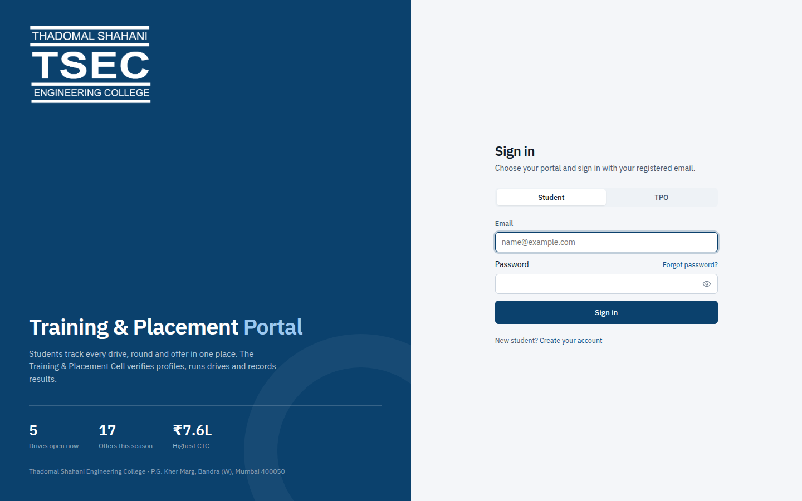 | 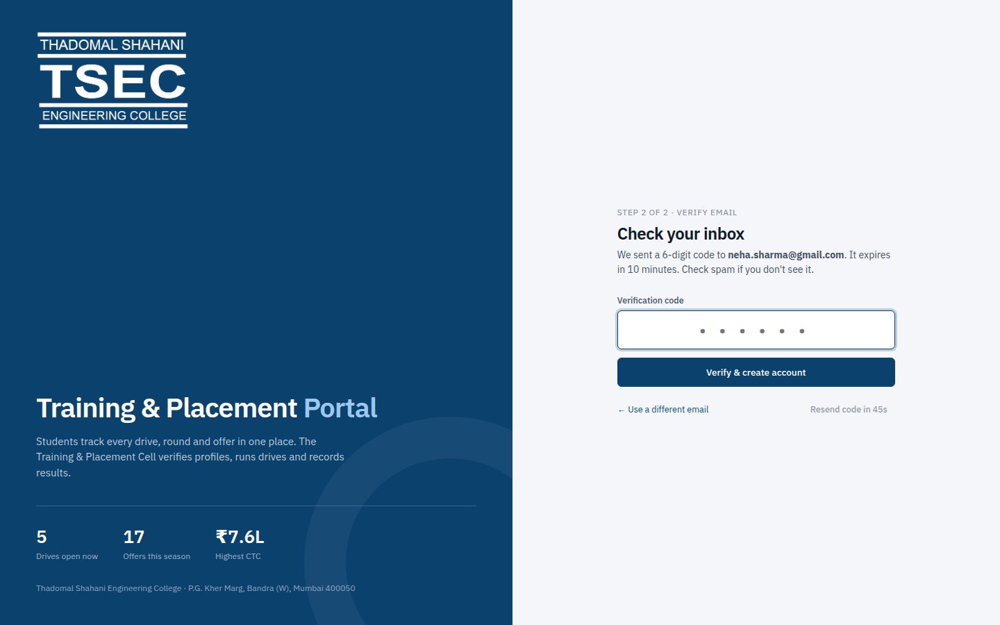 |
| 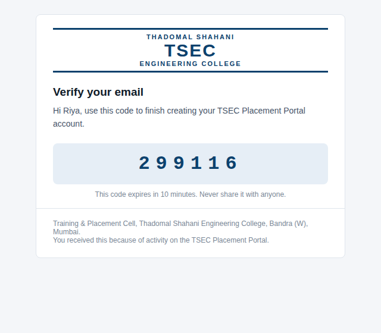 | 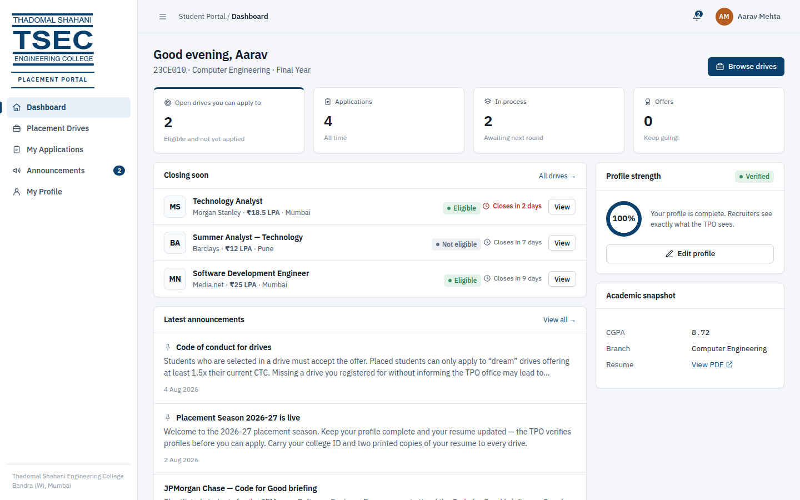 |
| 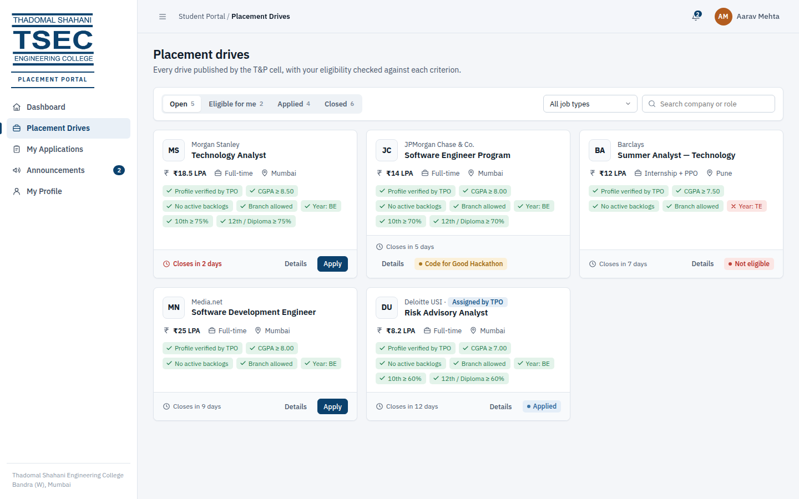 | 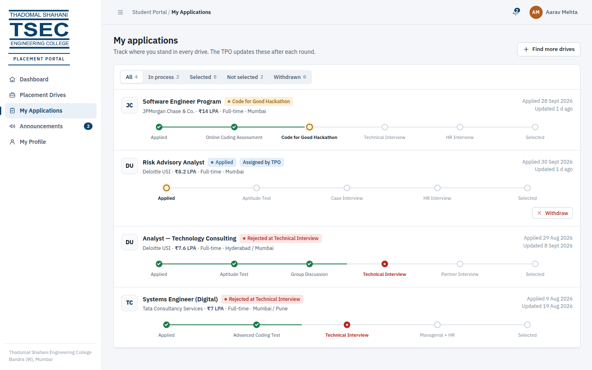 |
| 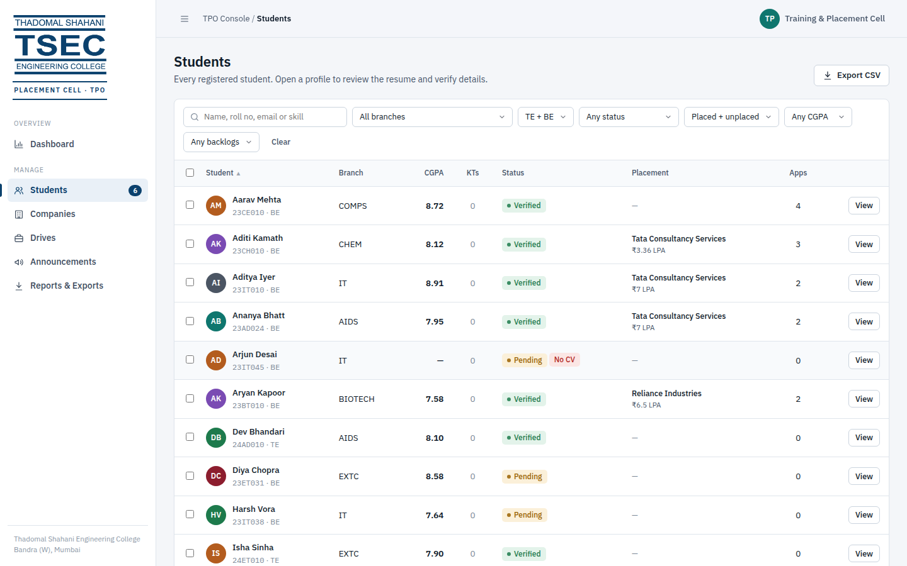 | 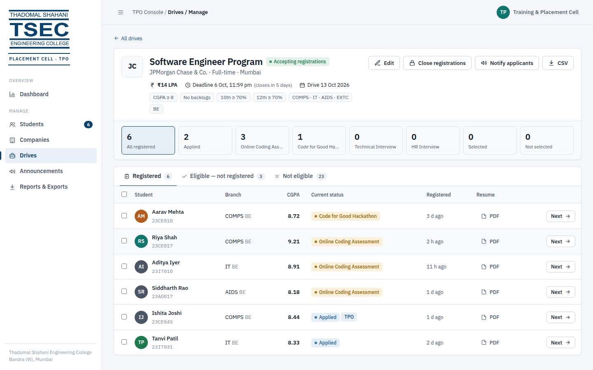 |
| 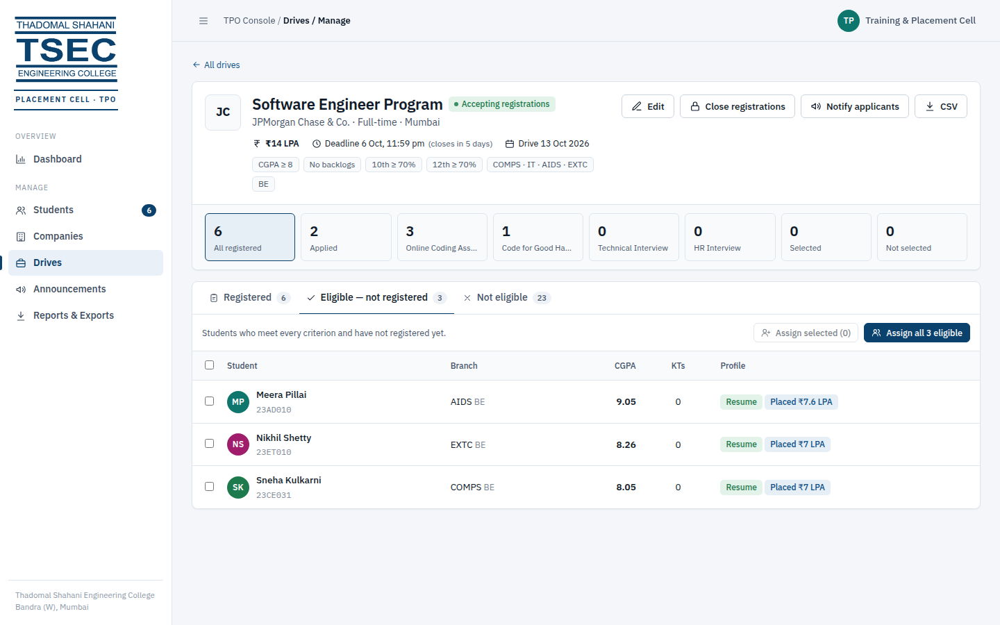 | 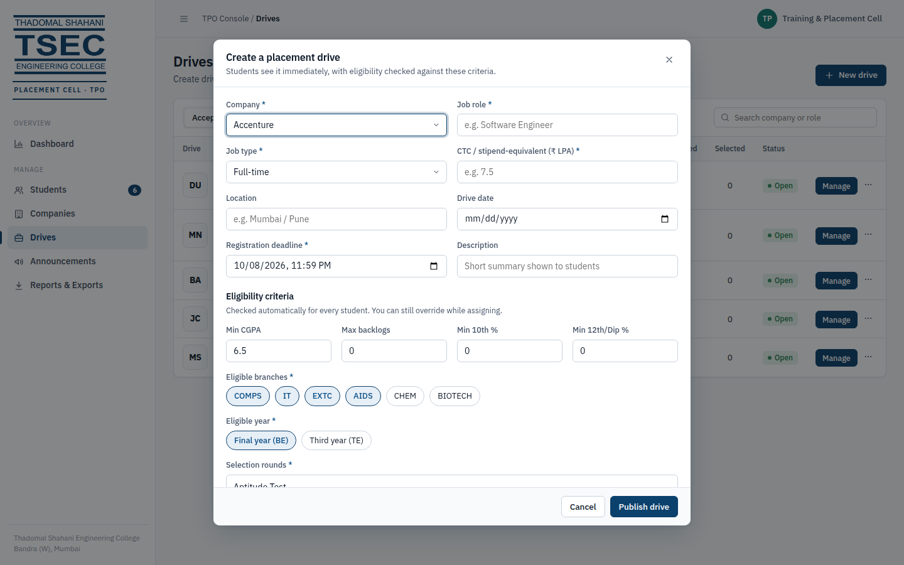 |

---

*Sample data from `npm run demo` (students, CTCs, contacts) is fictional. Company names are used only as sample recruiters.*
